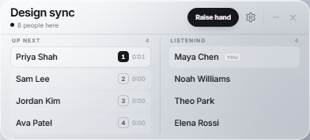
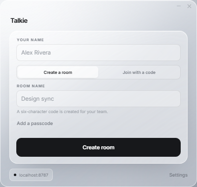
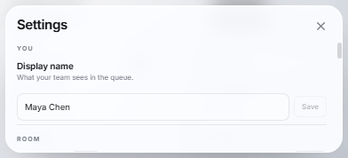

# Team Talkie

A tiny, private speaking queue for small teams. It floats above Zoom, Teams, Meet,
Discord — or any other call — and shows one thing: **who wants to speak, in what order**.

No accounts. No chat. No meeting plugins. Eight people, one quiet list.



## What it does

- **One-click hand raise.** Everyone in the room sees the queue update instantly. The hand
  control sits in the single top bar, so the window only grows by the rows it needs.
- **Clear, monochrome glass.** No accent colors. The window uses Windows acrylic or macOS
  vibrancy for a real blurred backdrop, with a light gray frosted skin on top.
- **Ordered queue.** Hands are timestamped by the server, so the order is the same for
  everyone. The person at the top is clearly marked as next.
- **Side-by-side at a glance.** Raised hands sit on the left, listening teammates on the
  right, in a window that shrinks to its content.
- **Up to eight people.** Small by design. There is also a short reconnect grace so a
  dropped Wi-Fi connection does not lose your place in line.
- **Private rooms.** A room code (plus an optional passcode) is the only key. The host
  can lock the room or end it for everyone.
- **Always on top.** The widget floats over full-screen meeting windows and other apps.
- **Invisible to screen shares.** On Windows 10 2004+ and macOS, the window is excluded
  from screen capture at the OS level. It still appears on your own display.
- **Ephemeral.** Rooms live in memory. Nothing is written to a database and everything
  disappears when the room ends.

It is deliberately small: a content-sized desktop widget with one button. **Settings** and
**Invite** scroll inside whatever height the room already has, so opening them never
stretches the widget.

## Screenshots

<p>
  
  
</p>

## Quick start

Requires Node.js 22 or newer.

```bash
npm install
npm run dev
```

That starts:

- the realtime server on `ws://localhost:8787`
- the Electron widget with hot reload

The first launch shows the welcome screen. Enter a name, create a room, and press
**Create room**. Use **Invite** to copy the code for your team.

To try the UI in a browser (no always-on-top or screen-capture protection there):

```bash
npm run dev:web
# open http://localhost:5175
```

## How it works

```
┌─────────────────────┐        WebSocket         ┌─────────────────────┐
│  Electron renderer  │◀════════════════════════▶│  Node server        │
│  React + CSS glass  │          ws / wss        │  in-memory rooms    │
└──────────┬──────────┘                          └─────────────────────┘
           │ IPC
┌──────────▼──────────┐
│  Electron main      │  tray · always-on-top · screen-capture exclusion
│  Windows / macOS    │  deep links · settings · notifications
└─────────────────────┘
```

- `packages/protocol` — shared message types and tiny helpers, used by both sides.
- `apps/server` — a single Node process with `ws`. Rooms, passes, host controls and
  reconnect grace all live in RAM.
- `apps/desktop` — Electron + React. The main process owns the window, tray, screen
  capture exclusion and global shortcut; the renderer owns the room state and UI.
- The only persistent state is local: your name, preferred server, and the last
  room (including an optional passcode) for automatic rejoin.

The server sends the queue order as server timestamps, so clocks on different machines
never affect who is next.

## Configuration

### Desktop app

Open **Settings** (on the welcome screen, or the gear in the room's top bar) to change:

- display name
- server URL
- sounds
- always-on-top / hide-from-screen-share / close-to-tray / launch-at-login
- shortcuts

To bake a server URL into a build, create `apps/desktop/.env`:

```bash
VITE_TALKIE_SERVER=wss://your-service.run.app
```

Source builds default to `ws://localhost:8787`; release builds bake in a public server
(below). The app accepts `https://` / `wss://` URLs and appends `/ws` when needed.

### Hosted server

Release builds point at:

```
wss://talkie-420782505771.us-central1.run.app
```

That instance runs on Google Cloud Run in the maintainer's TAMU project (us-central1),
scales to zero when idle, and wakes on the app's first request. It is rate limited per IP
for room creation, joins, and concurrent connections. Anyone can point the app at their
own server instead in **Settings**.

### Server

| Variable | Default | Description |
| --- | --- | --- |
| `PORT` | `8787` | HTTP/WebSocket port |
| `HOST` | `0.0.0.0` | bind address |
| `ALLOWED_ORIGINS` | *(empty = any)* | comma-separated origins for browser clients; `file://` / native clients are always allowed |
| `TRUST_PROXY` | `0` | set to `1` behind Cloud Run / a reverse proxy to use `X-Forwarded-For` for rate limits |
| `LOG_LEVEL` | `info` | `debug`, `info`, `warn`, `error` |
| `ROOM_IDLE_MS` | 30 min | how long an empty room is kept for rejoining |
| `ROOM_MAX_AGE_MS` | 24 h | hard lifetime of a room |
| `RECONNECT_GRACE_MS` | 8 s | how long a dropped member keeps their seat and place |
| `MAX_ROOMS` | 2000 | capacity guard for the process |

Rooms are capped at **8 members** and each member is capped at one hand in the queue.
Join attempts and general messages are rate limited, and frame payloads are capped at 16 KB.

## Deploying the server

The server is a standalone bundled ESM file, so the Docker image only needs Node and
`dist/server.js`.

```bash
npm run build:server
```

See **[docs/deploy-cloud-run.md](docs/deploy-cloud-run.md)** for a complete Google Cloud
Run walkthrough (including the single-instance and WebSocket details). The short version:

```bash
gcloud run deploy team-talkie \
  --source apps/server \
  --region us-central1 \
  --allow-unauthenticated \
  --port 8080 \
  --max-instances 1 \
  --min-instances 1 \
  --timeout 3600 \
  --set-env-vars TRUST_PROXY=1,LOG_LEVEL=info
```

Then put `wss://<service-url>` into the widget's Settings.

## Building installers

```bash
npm run dist:win    # Windows NSIS installer
npm run dist:mac    # macOS DMG/ZIP — run this on macOS
```

Artifacts go to `apps/desktop/release/`. Code signing and notarization are not
configured; add your certificate before distributing. The app registers the
`talkie://join/CODE` protocol so invite links can open it.

## Tests and quality checks

```bash
npm run typecheck   # protocol + server + desktop
npm test            # server room/queue tests (16)
npm run smoke       # end-to-end WebSocket smoke test against the built server
npm run build       # production build of both apps
```

The capture script used for the README images is in `scripts/capture.cjs`. It loads the
built renderer offscreen, creates a room, and writes screenshots to `docs/`. Run it with
the built app and a local server:

```bash
npm run build:server
npm run build:app
npm run dev:server   # in another terminal
npm run capture
```

## Privacy and screen capture

- **Transport:** use `wss://` in production (Cloud Run gives you TLS automatically).
  Local development uses plain `ws://`.
- **Storage:** the server keeps rooms in memory only. There is no chat or message
  history to store. Passcodes are hashed with scrypt; room codes are generated with
  `crypto.randomInt`.
- **Room access:** six-character codes are a shared secret. An optional passcode adds a
  second factor. The host can lock the room.
- **Local data:** the desktop app stores your display name, preferences and last room in
  the Electron profile. The last room's passcode is stored locally to make auto-rejoin
  work; remove the app's data directory if you need to forget it.
- **Capture exclusion:** the window uses Electron's native content-protection APIs —
  `SetWindowDisplayAffinity(WDA_EXCLUDEFROMCAPTURE)` on Windows and
  `NSWindowSharingNone` on macOS. This is best effort. Some capture tools or older OS
  versions can ignore it, and the widget still appears on your physical display. Linux
  does not offer an equivalent API here.
- **Notifications:** when screen-capture exclusion is on, desktop notifications use a
  generic body so a teammate's name does not leak into a screen share.
- This is a coordination tool for small, trusted teams, not a secure messenger.

## Intentional limits

- **Single instance.** Room state is in one process. Horizontal scaling would need a
  shared store and pub/sub (Redis/Firestore) — not included.
- **Cloud Run WebSockets** have a maximum request duration (60 minutes). The client
  reconnects automatically and resumes the same seat within the grace window.
- **No chat.** The app is only the queue.
- **Screen-capture protection is not available on Linux.**
- **No auto-update / signing.** Add those before wide distribution.

## Repository layout

```
apps/
  desktop/        Electron main + preload + React renderer
  server/         Node WebSocket server, Dockerfile, tests
packages/
  protocol/       Shared wire protocol and helpers
docs/             Screenshots and deployment notes
scripts/          Icon generation, smoke test, visual capture
```
